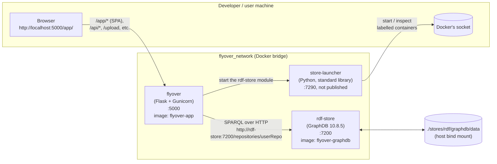
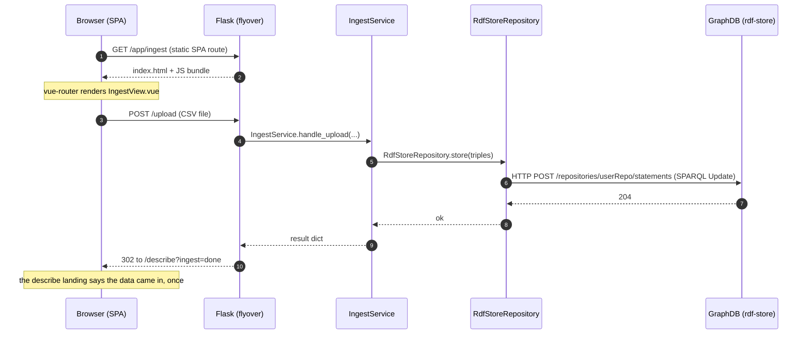
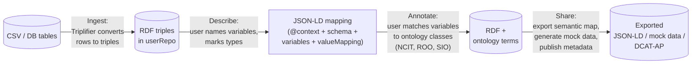

# Architecture

This doc maps the running system — what processes exist, how a browser request flows through them, and where data is stored. It also explains two concepts that are load-bearing but easy to get wrong if you don't know them: the GraphDB `userRepo`, and the JSON-LD mapping that ties the workflow steps together.

## System at a glance

Flyover runs as **three containers plus a browser**, defined in [`docker-compose.yml`](../docker-compose.yml):



- The browser only ever talks to **`flyover`** on port 5000. Flask serves the Vue SPA bundle (from `/app/data_descriptor/spa/` inside the container) and exposes the JSON API. The SPA's `vue-router` lives at the base path `/app/`.
- **`flyover`** talks to **`rdf-store`** over the internal Docker network using its hostname `rdf-store`. There is no `host` networking; the bridge `flyover_network` keeps everything isolated from the rest of the host.
- The GraphDB home directory is persisted on the host at `./stores/rdf/graphdb/data` (bind mount). That's where the actual triples live across restarts.
- **`rdf-store`** does not run until a user chooses to work on it. `docker compose create` creates it, and `docker compose up -d flyover` starts only Flyover and **`store-launcher`**. Flyover has no access to Docker; the launcher holds Docker's socket and does no more than start and inspect the containers of its own Compose project labelled `org.flyover.module` (see [Starting the store](#starting-the-store)).

In **test mode**, [`docker-compose.test.yml`](../docker-compose.test.yml) overlays this stack to replace the bind mount with a tmpfs volume, so every test run starts from a clean GraphDB. See [`testing.md`](testing.md) for that story.

## Request lifecycle

A typical "user uploads a CSV" round trip:



Two things to notice:
- **Flask serves both the SPA and the API.** The SPA's HTML / JS / CSS are static files copied into the image at build time ([`app/Dockerfile`](../app/Dockerfile) stage 1 → stage 2). There is no separate static-asset server in production.
- **The Flask layer is thin.** Controllers do HTTP parsing and call services; services orchestrate; repositories own the SPARQL queries. This is the three-tier shape that lets the unit tests in [`tests/unit/`](../app/backend/data_descriptor/tests/unit/) mock the repository without touching real GraphDB.

## Data flow: CSV → RDF → SPARQL → UI

Flyover's UI is four steps (Ingest → Describe → Annotate → Share), but it's easier to understand as four **data transformations** with a single durable artefact — the JSON-LD mapping — that survives between steps:



The JSON-LD mapping is **the** durable document that the user is editing across screens. Every Vue view either reads from it, writes to it, or both. The Flask backend keeps it in `session_cache` (the `SessionCache` in [`app_factory.py`](../app/backend/data_descriptor/app_factory.py)), with the browser holding a copy in IndexedDB so reloads don't lose state.

## Backend layers

The Flask side at [`app/backend/data_descriptor/`](../app/backend/data_descriptor/) is organised as four layers:

- **[`controllers/`](../app/backend/data_descriptor/controllers/)** — One Flask Blueprint per workflow step (`ingest_bp`, `describe_bp`, `annotate_bp`, `share_bp`), plus `suggestions_bp` and `project_bp` (see [Projects and the store in use](#projects-and-the-store-in-use)). Each route does HTTP parsing only — pulls JSON or form data, calls a service, packages the response. Many landing routes are now just `redirect("/app/...")` because the SPA owns the page rendering.
- **[`services/`](../app/backend/data_descriptor/services/)** — Business logic. `IngestService` runs the Triplifier and writes to GraphDB; `RdfStoreService` is the higher-level wrapper around the repository; `ShareService` does export and mock-data generation; etc. Services are the right place to add new behaviour — they're the layer the unit tests exercise most heavily.
- **[`repositories/`](../app/backend/data_descriptor/repositories/)** — `RdfStoreRepository` owns the actual HTTP calls to GraphDB's REST API; `query_builder.py` constructs the SPARQL strings. Anything that touches `requests.post("http://rdf-store:7200/...")` belongs here.
- **`session_cache`** — The one `SessionCache` instance [`create_app()`](../app/backend/data_descriptor/app_factory.py) puts into `APP_CONTEXT`, shared by every request. Holds the current user's in-flight state: the loaded CSV, the JSON-LD mapping under construction, the list of variables, etc. It's process-local, so the app is **not** safe to scale horizontally without changes.
- **[`app_factory.py`](../app/backend/data_descriptor/app_factory.py)** — `create_app()` registers the blueprints and the SPA route (the built files, and `index.html` for client routes; an unknown `/api/` path or a missing asset is a 404), refuses state-changing requests whose `Origin` (or `Referer`) names another site (the forms carry no CSRF token), answers errors on the JSON API (`/api/`, and for clients that ask for JSON) as `{"error": ...}` while page routes keep Flask's HTML pages, wires response compression ([`utils/response_compression.py`](../app/backend/data_descriptor/utils/response_compression.py)) and builds `APP_CONTEXT`: the session cache, the store selection, the RDF store, suggestion and project services, and the helpers the controllers call (triplifier run, graph upload, background jobs, name matching, fetching a map from a web address). [`data_descriptor_main.py`](../app/backend/data_descriptor/data_descriptor_main.py) is the gunicorn entry point: it applies gevent's monkey patching and logging, then calls `create_app()` with the settings it reads from the environment. Tests call the factory with their own settings and services.

If you're hunting a bug, work from the outside in: controller → service → repository. The controller usually just hands the request body to the service.

## Projects and the store in use

A project is a JSON-LD map the user opened on purpose (see the [README](../README.md#projects)). The browser keeps the project's working copy in IndexedDB; the server keeps what it needs to work on it.

**The store selection** ([`services/store_selection.py`](../app/backend/data_descriptor/services/store_selection.py)). `StoreSelection` holds the store the app works on: the configured one (`FLYOVER_RDF_STORE_URL`, `FLYOVER_REPOSITORY_NAME`) or the one an open project's map names in its top-level `endpoint`. `APP_CONTEXT["rdf_store_service"]` is a `SelectedStoreService`: it hands every call to the selected store's `RDFStoreService`, and a request keeps the store it first used, so a project that changes mid-request never splits that request over two stores. The graph upload and the relationship jobs an ingest starts take `pin_store(...)` once, so they finish on the store they started on. An endpoint is usable when its path holds `/repositories/<name>` (anything after the name, such as `/statements`, is dropped); a `localhost` or loopback endpoint means the configured store with the map's repository. Credentials in an endpoint are used, but never shown or logged. The browser is told a store's address as its users know it: the configured store at `FLYOVER_RDF_STORE_PUBLIC_URL` (compose sets `http://localhost:7200`, where it publishes the store; the app itself uses `http://rdf-store:7200`), and a map's `localhost` endpoint the same way.

**The project service** ([`services/project_service.py`](../app/backend/data_descriptor/services/project_service.py)) behind [`controllers/project_controller.py`](../app/backend/data_descriptor/controllers/project_controller.py):

| Route | What it does |
|---|---|
| `GET /api/v1/project` | The open project (or none), the route chosen (`project`, `standard` or none yet), the store in use and the configured store |
| `PUT /api/v1/project` | Open the posted map as the project: it becomes the session's map, and the store its endpoint names the store in use, started if Flyover may |
| `DELETE /api/v1/project` | Work without a project, in the standard RDF flow (also how a user chooses it at start-up); starts the configured store if Flyover may |
| `POST /api/v1/project/check` | What opening a map would mean (can it be opened, which project, which store), changing nothing |
| `GET /api/v1/project/store-status` | Where the store in use stands: `waiting` (nobody chose yet), `starting`, `reachable` or `unreachable` (with why), from one short `ASK` and the launcher; the status bar asks every minute while its tab is visible |
| `POST /api/v1/project/fetch-map` | A map from an http(s) address, fetched by the server (5 s to connect, 30 s between bytes, at most 20 MB); a file's page on Bitbucket, Forgejo, Gitea, GitHub, GitLab or SourceHut is read through its raw file, and a Zenodo record or DOI through Zenodo's API ([`utils/raw_file_address.py`](../app/backend/data_descriptor/utils/raw_file_address.py)); a record that holds several maps answers with them to choose from |

### Starting the store

Flyover starts its own store only once a user has chosen to work on it: by opening a project whose map names it (a `localhost` endpoint, or none), or by continuing without a project (`DELETE /api/v1/project`). The project service remembers that choice, the route, in its state file, so a new worker knows it; until someone chooses, the store status is `waiting`. [`services/store_lifecycle.py`](../app/backend/data_descriptor/services/store_lifecycle.py) decides what to start and where a store stands: a store on the configured store's server (any repository) is Flyover's to start, where the stack runs a launcher (`FLYOVER_STORE_LAUNCHER_URL`); a store elsewhere, or any store without a launcher, counts as running. [`services/store_launcher.py`](../app/backend/data_descriptor/services/store_launcher.py) asks the launcher ([`stores/launcher/`](../stores/launcher/launcher.py)) to start the module (`FLYOVER_RDF_STORE_MODULE`, default `rdf-store`) and what state it is in. A store that does not answer yet counts as `starting` for five minutes after its container started; after that, or when its container is stopped or missing, it is `unreachable`, with the reason. Flyover never stops a store: it may serve others too. A future `none` state is reserved for work that uses no database (a mapped CSV export kept in memory).

The launcher answers `GET /modules/<module>` and `POST /modules/<module>/start` on the stack's network only. It starts the module's containers that are not running, in their `org.flyover.start-order`, and never creates, stops or removes anything. Because a stopped store is a stopped container, people can also start one without Flyover (`docker compose start rdf-store-graphdb`), and `restart: unless-stopped` brings a store that ran back after a restart of the machine. Another module (an OMOP database under `stores/omop/`) needs only its compose service and the label.

**The store's datasets** ([`services/store_datasets.py`](../app/backend/data_descriptor/services/store_datasets.py)) behind [`controllers/store_controller.py`](../app/backend/data_descriptor/controllers/store_controller.py), for the status bar's panel. A dataset is one ingested table: `http://data.local/<name>/`, `http://ontology.local/<name>/` (columns, positions, describe answers), `http://annotation.local/<name>/`, `http://materialized.local/<name>/`, and its rows' links in the shared `http://relationships.local/`.

| Route | What it does |
|---|---|
| `GET /api/v1/store/datasets` | Every dataset, with its rows and whether it was described and annotated |
| `DELETE /api/v1/store/datasets/<name>` | One dataset: its links first (its data graph tells them apart), then its graphs |
| `DELETE /api/v1/store/datasets` | Every graph Flyover writes, dataset by dataset; never `DROP ALL` |
| `DELETE /api/v1/store/annotations` | Every annotation and materialised inference, dataset by dataset; data and describe answers stay |
| `GET /api/v1/store/datasets/<name>/export`, `/api/v1/store/export`, `/api/v1/store/annotations/export` | What the matching delete removes, as one TriG file |

They work on the store the request works on, go straight to its RDF4J-style endpoints (so a refusal surfaces with its status), and after a delete the session forgets what it knew of the deleted datasets. Each dataset's operations go in one update request, so GraphDB and RDF4J apply them as one transaction (a dataset goes entirely or not at all); a store that refuses a request of several operations (HTTP 400 or 501) gets them one by one. Datasets are deleted one after another, not in parallel: a repository commits one write at a time anyway.

Two maps belong to the same project when their `schema` sections do: the same `schema.@id` when both have one, else the same `schema.name`. On every change of project, the server forgets the session state worked out for the previous map (the annotation status, pasted LLM answers, suggestion jobs, the describe answers the forms posted); on a change of store, also what it knew of the previous store's databases. The data in the stores is never touched.

gunicorn runs one worker with `--preload` and replaces it every thousand or so requests (the status bar's check adds about 60 an hour per visible tab); a new worker starts from the app as it was built, without the session's in-memory state. The open project is therefore also written to `state/open_project.json` beside the package (outside `static/`, readable by the app only, as an endpoint may carry credentials), and every request first catches up with that file (`ProjectService.sync`, one `stat` when nothing changed). When the container itself is recreated the file is gone, and the browser sends its project again, under the same token, the next time Flyover opens.

## What is `userRepo`?

A GraphDB **instance** is one server. Inside it you can create many **repositories** — independent triple stores, each with its own ruleset (RDFS / OWL / none), storage, and access control. They don't share triples. Flyover uses exactly one repository called `userRepo`, configured by [`stores/rdf/graphdb/data/data/repositories/userRepo/config.ttl`](../stores/rdf/graphdb/data/data/repositories/userRepo/config.ttl).

Why this matters operationally:

- **In production**, `./stores/rdf/graphdb/data` is bind-mounted into the container. GraphDB writes its repositories there. Restarting the container preserves data.
- **In tests** (`docker-compose.test.yml`), the bind mount is replaced with a tmpfs and the container starts blank. To make `userRepo` exist on a fresh boot, the `rdf-store` image bakes in a seed at `/opt/graphdb-seed/` (Dockerfile copies [`stores/rdf/graphdb/seed/users.js`](../stores/rdf/graphdb/seed/users.js), [`stores/rdf/graphdb/seed/settings.js`](../stores/rdf/graphdb/seed/settings.js), and the `userRepo/config.ttl`). The image's entrypoint, [`stores/rdf/graphdb/seed-entrypoint.sh`](../stores/rdf/graphdb/seed-entrypoint.sh), does a non-clobbering `cp -rn /opt/graphdb-seed/. /opt/graphdb/home/` before launching GraphDB. On a bind-mounted prod start, that copy skips everything (files already exist); on a fresh tmpfs, it populates the empty store with the seed.

The seed contains stock GraphDB defaults only — single admin user with the documented default password. **Never commit live user state into `stores/rdf/graphdb/seed/`.**

The Flask backend learns which repository to use from the env var `FLYOVER_REPOSITORY_NAME=userRepo` (set in [`docker-compose.yml`](../docker-compose.yml)). Changing that without also seeding a config.ttl for the new repository will break ingest. An open project's map may name another repository (or another store); Flyover never creates one, so it must exist before the project is used.

## What is JSON-LD?

JSON-LD is JSON with one extra key: `@context`. The context maps every other key in the document to a URI, so the same document is both **valid JSON** (parseable by anything) and **an RDF graph** (every key:value becomes a triple). It's how Flyover stores semantic mappings without forcing users to think in triples.

Here's a stripped-down example pulled from [`tests/conftest.py::sample_jsonld_mapping`](../app/backend/data_descriptor/tests/conftest.py):

```jsonc
{
  "@context": {                                  // tells RDF tools what each key MEANS
    "@vocab": "https://github.com/MaastrichtU-CDS/Flyover/",
    "schema": "schema/",
    "mapping": "mapping/"
  },
  "@id": "https://flyover.example.org/mapping/test",  // global identifier for this document
  "@type": "mapping:DataMapping",                // RDF class — "this is a DataMapping"
  "name": "Test Mapping",
  "schema": {
    "@type": "schema:SemanticSchema",
    "prefixes": {                                 // ontology prefixes used downstream
      "ncit": "http://ncicb.nci.nih.gov/xml/owl/EVS/Thesaurus.owl#",
      "roo":  "http://www.cancerdata.org/roo/"
    },
    "variables": {
      "biological_sex": {
        "@type": "schema:CategoricalVariable",
        "predicate": "roo:P100018",               // RDF predicate to use
        "class":     "ncit:C28421",               // ontology class for the variable
        "valueMapping": {
          "terms": {
            "male":   { "targetClass": "ncit:C20197" },  // value → ontology term
            "female": { "targetClass": "ncit:C16576" }
          }
        }
      }
    }
  }
}
```

If you've worked with plain JSON, the only new ideas are: `@id` (global identifier), `@type` (RDF class), `@context` (key → URI map). Everything else is just nested objects. The [json-ld.org primer](https://www.w3.org/TR/json-ld11/) is the canonical 30-minute read.

## Learn more

- [W3C RDF 1.1 Primer](https://www.w3.org/TR/rdf11-primer/) — what triples and SPARQL even are
- [JSON-LD 1.1 Primer](https://www.w3.org/TR/json-ld11/) — the only document you need on JSON-LD itself
- [GraphDB Documentation](https://graphdb.ontotext.com/documentation/10.8/) — especially the "Repositories" and "REST API" sections
- [Flask Blueprints](https://flask.palletsprojects.com/en/stable/blueprints/) — Flyover's controllers are blueprints
- [GO-FAIR — FAIR Principles](https://www.go-fair.org/fair-principles/) — what Flyover is helping users achieve

If something here is wrong or unclear, fix it — that's the easiest contribution you'll ever make.
